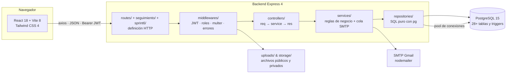
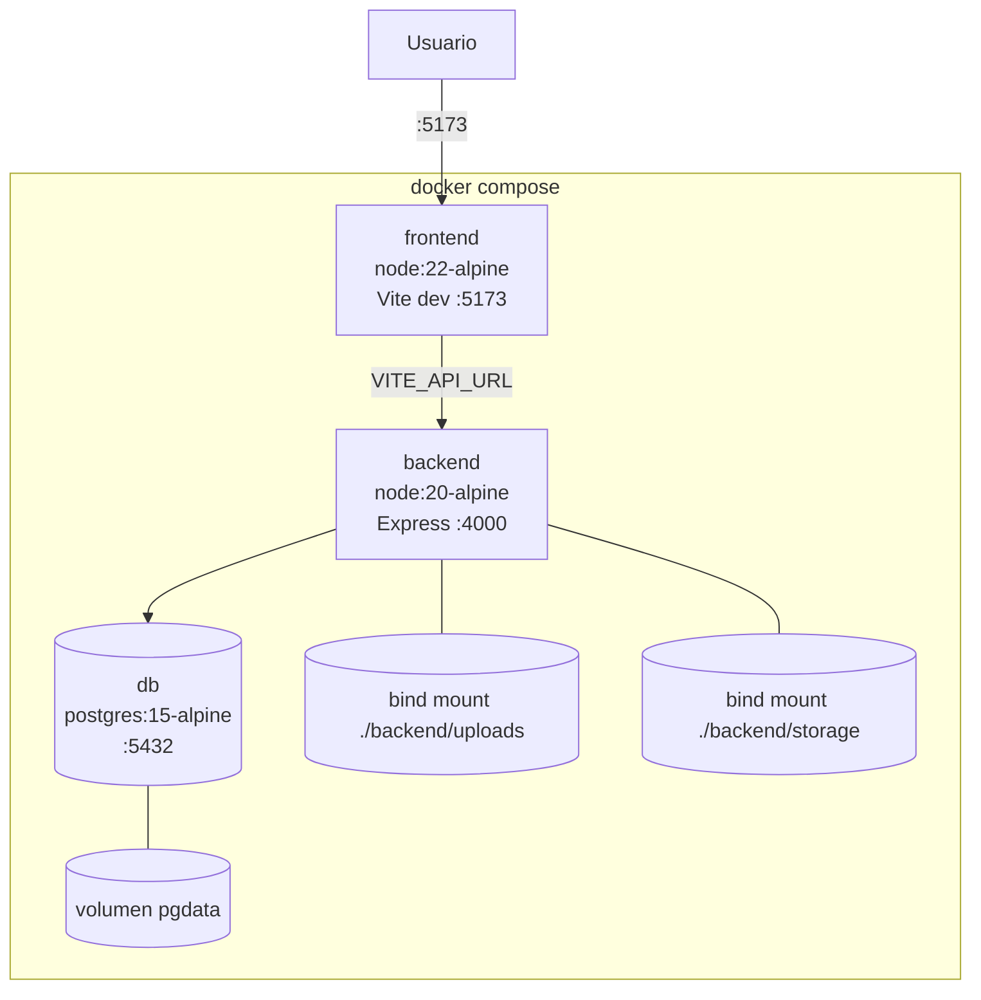

<div align="center">

# 🤝 Sistema de Donaciones y Voluntariados

**Plataforma web integral para conectar donantes, voluntarios, coordinadores, beneficiarios y administradores.** Incluye autenticación y gestión de usuarios, campañas y actividades, donaciones con recepción e inventario central, gestión de voluntarios (disponibilidad, solicitudes, asistencia y seguimiento), beneficiarios y ayudas con evidencias, y reportes con notificaciones por correo. Interfaz accesible en modo claro y oscuro.


**Documento de onboarding técnico para equipos de desarrollo**

`Usuarios & Auth` · `Campañas & Actividades` · `Donaciones & Inventario` · `Voluntarios` · `Beneficiarios & Ayudas` · `Reportes & Notificaciones`

</div>

---

> [!IMPORTANT]
> **Antes de escribir código, leé las secciones [5](#5-arquitectura), [9](#9-backend), [11](#11-frontend) y [17](#17-guía-para-equipos).**
> Este README es el contrato técnico del proyecto: describe cómo está construido, qué módulos operan hoy, cómo se estructura la base de datos y cómo mantener la consistencia del sistema.

---

## Tabla de contenidos

1. [Visión general](#1-visión-general)
2. [Inicio rápido](#2-inicio-rápido)
3. [Estado actual del proyecto](#3-estado-actual-del-proyecto)
4. [Roles y permisos](#4-roles-y-permisos)
5. [Arquitectura](#5-arquitectura)
6. [Stack tecnológico](#6-stack-tecnológico)
7. [Estructura del proyecto](#7-estructura-del-proyecto)
8. [Base de datos](#8-base-de-datos)
9. [Backend](#9-backend)
10. [Referencia de la API](#10-referencia-de-la-api)
11. [Frontend](#11-frontend)
12. [Sistema de diseño](#12-sistema-de-diseño)
13. [Pantallas y rutas](#13-pantallas-y-rutas)
14. [Puesta en marcha](#14-puesta-en-marcha)
15. [Usuarios de prueba](#15-usuarios-de-prueba)
16. [Comandos útiles](#16-comandos-útiles)
17. [Guía para equipos](#17-guía-para-equipos)
18. [Deuda técnica y roadmap](#18-deuda-técnica-y-roadmap)
19. [Troubleshooting](#19-troubleshooting)
20. [Glosario](#20-glosario)

---

## 1. Visión general

### 1.1 Qué es

Una plataforma web para gestionar el ciclo completo de la ayuda solidaria:

- **Donantes** registran donaciones (alimentos, materiales o aportes económicos), adjuntan fotografías, consultan el seguimiento y descargan comprobantes.
- **Voluntarios** registran su disponibilidad semanal, se inscriben a actividades de campañas y acumulan historial y horas acreditadas.
- **Coordinadores** revisan solicitudes de voluntariado, consultan la disponibilidad del equipo y registran la asistencia de voluntarios en actividades.
- **Beneficiarios** (persona, familia o institución) gestionan su ficha, envían solicitudes de ayuda con adjuntos y reciben entregas/apoyos trazables.
- **Administradores** gestionan cuentas, campañas, actividades, recepciones, inventario, asignaciones, entregas, seguimiento global, reportes y notificaciones masivas o programadas.

### 1.2 Alcance funcional actual

| Módulo                                 | Estado          | Alcance real                                                                                                                   |
| -------------------------------------- | --------------- | ------------------------------------------------------------------------------------------------------------------------------ |
| Autenticación y sesión                 | ✅ Implementado | Registro público, login JWT (8 h), `POST /api/auth/refresh`, recuperación SMTP (1 h), cierre por inactividad (15 min)          |
| Gestión de usuarios y perfil           | ✅ Implementado | CRUD admin, roles y subtipos, activar/desactivar, borrado lógico, foto en `/uploads/perfiles`, mapa Leaflet para donantes      |
| Campañas y actividades                 | ✅ Implementado | CRUD de campañas y actividades, secciones públicas en landing, inscripción/desinscripción, control de cupo y asistencia        |
| Donaciones, inventario y entregas      | ✅ Implementado | Registro propio/presencial, recepciones, trigger automático a `inventario`, fotos privadas, asignaciones, entregas y PDF         |
| Gestión de voluntarios                 | ✅ Implementado | Solicitudes con historial, disponibilidad personal (`mi-disponibilidad`), disponibilidad del equipo, asistencia y seguimiento  |
| Beneficiarios y ayudas                 | ✅ Implementado | Fichas, solicitudes de ayuda, evaluaciones, adjuntos (PDF/JPG/PNG), apoyos y evidencias fotográficas de entrega                |
| Reportes y notificaciones (Sprint 6)   | ✅ Implementado | Reportes filtrados por fechas (donaciones, voluntariado, campañas, solicitudes), exportación CSV, envío y cola SMTP cada 30 s  |
| Dashboard                              | 🟡 Mixto        | Postulaciones de rol, bandejas de revisión y accesos directos a todos los módulos; tarjetas KPI de resumen aún son referenciales |

### 1.3 Principios de diseño del sistema

1. **Separación por capas:** el controlador no ejecuta SQL; el repositorio no conoce HTTP (`req`/`res`).
2. **SQL puro y explícito:** sin ORM, usando `pg` con consultas parametrizadas (`$1, $2...`) y transacciones en operaciones multi-tabla.
3. **Integridad en base de datos:** triggers PostgreSQL garantizan saldos de inventario, inmutabilidad de auditoría, cupos en actividades, historial de voluntariado y promoción automática por asistencia.
4. **Contrato tipado:** `models/` (backend) y `types/` (frontend) definen las estructuras compartidas.
5. **Errores centralizados:** `AppError` para reglas de negocio y `errorMiddleware` para respuestas JSON consistentes.
6. **Tokens semánticos de diseño:** los componentes usan tokens (`bg-surface`, `text-text-muted`, etc.) compatibles con modo claro y oscuro.
7. **Accesibilidad y móvil primero:** contraste AA, foco visible, `100dvh`, `safe-area-inset-*` y `prefers-reduced-motion`.

---

## 2. Inicio rápido

### 2.1 Requisitos

| Herramienta    | Versión mínima                  |
| -------------- | ------------------------------- |
| Node.js        | 20 LTS                          |
| npm            | 10                              |
| Docker Desktop | última estable (con Compose v2) |
| Git            | cualquiera reciente             |

### 2.2 Puesta en marcha en 6 pasos

```powershell
# 1. Clonar
git clone https://github.com/T-T-MoY/Sistema_de_Donaciones_y_Voluntarios.git
cd Sistema_de_Donaciones_y_Voluntarios

# 2. Crear el .env de la raíz (ver sección 14.2)
#    Debe existir antes de levantar Docker.

# 3. Levantar solo PostgreSQL (aplica los 9 scripts de database/)
docker compose up -d db

# 4. Backend (terminal 1)
cd backend
npm install
npm run dev

# 5. Frontend (terminal 2; API_URL tiene fallback a http://localhost:4000/api)
cd frontend
npm install
npm run dev

# 6. Abrir http://localhost:5173
```

> Para configurar otra URL de API, crear `frontend/.env` con `VITE_API_URL`. En desarrollo local, el cliente compartido (`api/client.ts`) usa `http://localhost:4000/api` como fallback.

### 2.3 URLs

| Servicio             | URL                                          |
| -------------------- | -------------------------------------------- |
| Frontend             | http://localhost:5173                        |
| API                  | http://localhost:4000/api                    |
| Health check         | http://localhost:4000/api/health             |
| Documentación de API | Este README (no hay Swagger/OpenAPI todavía) |

### 2.4 Verificación rápida

```powershell
# Health check
Invoke-RestMethod http://localhost:4000/api/health

# Login de prueba
$body = @{ "correo" = "carla.admin@donacionesbo.org"; "contraseña" = "Passw123" } | ConvertTo-Json
$login = Invoke-RestMethod -Method Post -Uri http://localhost:4000/api/auth/login `
  -ContentType "application/json; charset=utf-8" -Body $body
$login.usuario

# Listado de usuarios (requiere token)
Invoke-RestMethod http://localhost:4000/api/usuarios `
  -Headers @{ Authorization = "Bearer $($login.token)" }
```

---

## 3. Estado actual del proyecto

### 3.1 Funcionalidades operativas

- **Landing pública (`/`)**: Hero, secciones dinámicas conectadas al backend (`CampanasSection`, `VoluntariadoSection`, `SolicitudesAyudaSection`, `InventarioDonacionesSection`), flujo `HowItWorks` y `ServicesShowcase`.
- **Autenticación (`/login`, `/registro`, `/solicitar-recuperacion`, `/reset-password`)**: registro como Donante, Beneficiario o Voluntario; login JWT; refresh de token; recuperación de contraseña vía SMTP Gmail.
- **Panel de Usuarios (`/usuarios`) y Perfil (`/perfil`)**: CRUD completo con búsqueda, filtros y paginación en cliente; actualización de perfil, contraseña y foto (`/uploads/perfiles`); mapa Leaflet para coordenadas de donantes.
- **Dashboard (`/dashboard`)**: postulación para habilitar subtipos (Donante, Voluntario, Beneficiario), bandejas de aprobación/verificación y accesos rápidos por rol.
- **Campañas y Actividades (`/campanas`)**: creación, edición y borrado lógico/estado de campañas y actividades; inscripción y desinscripción de voluntarios; toma de asistencia por coordinadores.
- **Donaciones e Inventario (`/donaciones`)**: registro propio y presencial (alimentos, materiales, económico), recepción física con ingreso automático a inventario, fotografías privadas en `backend/storage/donaciones`, asignaciones, entregas a beneficiarios, generación de comprobantes PDF y auditoría inmutable.
- **Gestión de Voluntarios (`/voluntarios/*` y `/mi-disponibilidad`)**:
  - `/voluntarios/solicitudes`: aprobación/rechazo de voluntarios con registro automático en `historial_voluntario`.
  - `/voluntarios/seguimiento`: vista administrativa global e historial por voluntario.
  - `/voluntarios/disponibilidad-equipo`: consulta de horarios y actividades del equipo (Coordinador/Admin).
  - `/voluntarios/asistencia`: control de asistencia a actividades (Coordinador).
  - `/mi-disponibilidad` y `/voluntarios/mi-disponibilidad`: gestión de bloques horarios personales.
- **Beneficiarios y Ayudas (`/beneficios`)**: fichas de beneficiario, solicitudes de ayuda con adjuntos, evaluaciones, apoyos y evidencias fotográficas de entrega.
- **Reportes y Notificaciones (`/reportes`)**: generación de reportes por rango de fechas, exportación CSV, envío inmediato o programado de correos con cola en segundo plano (cada 30 s) y reintento manual.

### 3.2 Pendiente o en evolución

- Conectar los KPIs de resumen del `Dashboard` a métricas reales agregadas de la BD (actualmente muestran valores de referencia).
- Tests automatizados (unitarios / integración), ESLint/Prettier y pipeline CI.
- Documentación OpenAPI / Swagger.
- Build de producción estático para el contenedor `frontend` (actualmente corre Vite dev server).

---

## 4. Roles y permisos

### 4.1 Nombres canónicos

El sistema posee cuatro subtipos en BD (`administrador`, `beneficiario`, `donante`, `voluntario`). El rol **Coordinador** corresponde a un voluntario aprobado con `es_coordinador = true`:

| Rol canónico (API/JWT) | Alias aceptados de entrada | Alias heredado del frontend | Tabla de subtipo                       |
| ---------------------- | -------------------------- | --------------------------- | -------------------------------------- |
| `Administrador`        | `admin`, `administrador`   | `Admin`                     | `administrador`                        |
| `Coordinador`          | `coordinador`              | `Coordinador`               | `voluntario` (`es_coordinador = true`) |
| `Beneficiario`         | `beneficiario`             | `Beneficiario`              | `beneficiario`                         |
| `Donante`              | `donante`, `cliente`       | `Cliente`                   | `donante`                              |
| `Voluntario`           | `voluntario`, `empleado`   | `Empleado`                  | `voluntario`                           |

### 4.2 Matriz de permisos por módulo

| Funcionalidad / Módulo                                     | Público | Donante | Voluntario | Coordinador | Beneficiario | Administrador |
| ---------------------------------------------------------- | :-----: | :-----: | :--------: | :---------: | :----------: | :-----------: |
| Ver landing y campañas/actividades públicas                |   ✅    |   ✅    |     ✅     |     ✅      |      ✅      |      ✅       |
| Registrarse (Donante, Beneficiario o Voluntario)           |   ✅    |    —    |     —      |      —      |      —       |       —       |
| Ver y editar perfil propio / foto / ubicación              |    —    |   ✅    |     ✅     |     ✅      |      ✅      |      ✅       |
| Postular a subtipos desde Dashboard                        |    —    |   ✅    |     ✅     |     ✅      |      ✅      |      ✅       |
| Gestión de usuarios (CRUD, estado, eliminar)               |    —    |    —    |     —      |      —      |      —       |      ✅       |
| Revisar solicitudes de voluntariado                        |    —    |    —    |     —      |     ✅      |      —       |      ✅       |
| Revisar verificación de beneficiarios                      |    —    |    —    |     —      |      —      |      —       |      ✅       |
| Campañas y actividades: consultar e inscribirse            |    —    |   ✅    |     ✅     |     ✅      |      ✅      |      ✅       |
| Campañas y actividades: crear, editar, eliminar            |    —    |    —    |     —      |      —      |      —       |      ✅       |
| Registrar asistencia en actividades                        |    —    |    —    |     —      |     ✅      |      —       |       —       |
| Donaciones: registrar propia / ver propias o asignadas     |    —    |   ✅    |     ✅     |     ✅      |      ✅      |      ✅       |
| Donaciones: registrar presencial / subir fotos             |    —    |    —    |     ✅     |      —      |      —       |      ✅       |
| Donaciones: recepciones, inventario, asignaciones, entrega |    —    |    —    |     —      |      —      |      —       |      ✅       |
| Voluntarios: mi disponibilidad                             |    —    |    —    |     ✅     |     ✅      |      —       |       —       |
| Voluntarios: disponibilidad del equipo                     |    —    |    —    |     —      |     ✅      |      —       |      ✅       |
| Voluntarios: seguimiento general                           |    —    |    —    |     —      |      —      |      —       |      ✅       |
| Beneficios y ayudas (fichas, solicitudes, apoyos)          |    —    |   ✅*   |    ✅*     |     ✅*     |     ✅*      |      ✅       |
| Evidencias fotográficas de entrega (subir)                 |    —    |    —    |     —      |      —      |      —       |      ✅       |
| Reportes (consulta propia o global según rol)              |    —    |   ✅    |     ✅     |     ✅      |      ✅      |      ✅       |
| Notificaciones por correo (crear, programar, reintentar)   |    —    |    —    |     —      |     ✅      |      —       |      ✅       |

> \* En `/api/ayudas`, el servicio `ayudaService.actor()` y las rutas controlan el alcance de fichas, solicitudes, evaluaciones y apoyos según el rol del usuario autenticado (los usuarios generales consultan lo propio o público aplicable; la evaluación, gestión administrativa y subida de evidencias corresponden a roles autorizados).

### 4.3 Estados de cuenta y de solicitud

- **Estado de cuenta (`usuario.estado`)**: `Activo` (opera normal), `Inactivo` (bloqueado en login con `403`), `Eliminado` (borrado lógico, bloqueado con `401`, oculto en listados).
- **Verificación de beneficiario (`beneficiario.estado`)**: `Pendiente` → `Verificado` | `Rechazado`.
- **Estado de voluntariado (`voluntario.estado`)**: `Pendiente` → `Aprobado` | `Rechazado`.
  - Un voluntario en estado `Pendiente` que registra asistencia en una actividad se promueve automáticamente a `Aprobado` mediante el trigger `trg_promover_voluntario_por_asistencia`.

---

## 5. Arquitectura

### 5.1 Vista general



### 5.2 Regla de dependencias del backend

```text
routes → middlewares → controllers → services → repositories → PostgreSQL
                                      ↘ utils / models / config / validators
```

- `controllers` no importa `pg` ni ejecuta SQL.
- `services` no conoce `req` ni `res`.
- `repositories` concentra el SQL parametrizado y transacciones (`BEGIN/COMMIT/ROLLBACK`).
- Nota: los módulos `seguimiento/` y `sprint6/` viven en carpetas propias bajo `backend/src/` (`seguimiento/` sigue el patrón completo controller/service/repository/model; `sprint6/sprint6Routes.ts` encapsula rutas, auditoría y cola de notificaciones).

### 5.3 Topología de despliegue (Docker Compose)



> El proyecto también incluye `docker-compose.db.yaml` para levantar únicamente PostgreSQL en desarrollo local con el volumen `pgdata_db_only`.

---

## 6. Stack tecnológico

### 6.1 Backend

| Tecnología            | Versión | Uso                                          |
| --------------------- | ------- | -------------------------------------------- |
| Node.js               | 20      | Runtime                                      |
| Express               | 4.19    | Framework HTTP                               |
| TypeScript            | 5.4     | Tipado estricto, compilado a CommonJS        |
| `pg`                  | 8.11    | Pool de conexiones y SQL puro                |
| `jsonwebtoken`        | 9.0     | Emisión y verificación de JWT                |
| `bcrypt`              | 5.1     | Hash de contraseñas                          |
| `multer`              | 1.4     | Subida de fotos de perfil, donación y ayudas |
| `nodemailer`          | 6.9     | Recuperación de clave y notificaciones       |
| `cors`                | 2.8     | CORS restringido a `FRONTEND_URL`            |
| `dotenv`              | 16.4    | Variables de entorno                         |
| `ts-node` + `nodemon` | 10 / 3  | Hot reload en desarrollo                     |

### 6.2 Frontend

| Tecnología          | Versión | Uso                                    |
| ------------------- | ------- | -------------------------------------- |
| React               | 18.2    | UI                                     |
| Vite                | 8.2     | Bundler y dev server                   |
| TypeScript          | 5.4     | Tipado estricto                        |
| React Router        | 7.18    | Ruteo SPA                              |
| Axios               | 1.6     | Cliente HTTP e interceptores           |
| Tailwind CSS        | 4.3     | Estilos mediante `@theme` y utilidades |
| `@tailwindcss/vite` | 4.3     | Plugin oficial, sin PostCSS            |
| `jwt-decode`        | 4.0     | Lectura del payload JWT en cliente     |
| `leaflet` / `react-leaflet` | 1.9 / 4.2 | Mapas de ubicación de donantes   |
| `jspdf` + `html2canvas` | 4.2 / 1.4 | Comprobantes y exportaciones PDF |
| `xlsx`              | 0.18    | Exportación de reportes                |
| `@nivo/pie` / `@nivo/heatmap` | 0.99 | Visualizaciones estadísticas     |
| `vite-plugin-svgr`  | 5.2     | Importar SVG como componente React     |

### 6.3 Infraestructura y calidad

| Herramienta             | Uso                                           |
| ----------------------- | --------------------------------------------- |
| Docker Compose          | Orquestación local de db + backend + frontend |
| PostgreSQL 15 Alpine    | Base de datos, TZ `America/La_Paz`            |
| SonarQube (local :9000) | Análisis estático de backend y frontend       |
| `scan-sonar.ps1`        | Ejecuta el scanner en contenedor              |

> No hay ESLint, Prettier, Vitest, Jest ni pipeline CI configurados todavía.

---

## 7. Estructura del proyecto

```text
Sistema de Donaciones y Voluntariados/
├── compose.yaml                         # db + backend + frontend
├── docker-compose.db.yaml               # solo db para desarrollo local
├── .env                                 # NO versionado; usado por Compose y backend
├── .gitignore
├── README.md
├── scan-sonar.ps1                       # Scanner SonarQube en Docker
├── docs/
│   └── INTEGRACION_CAMPANAS_SOLICITUDES.md
│
├── database/
│   ├── 01_schema.sql                    # Usuarios, Donaciones/Inventario, Campañas/Actividades + triggers
│   ├── 02_inserts.sql                   # Seeds iniciales (17 usuarios, catálogos, campañas, donaciones)
│   ├── 03_gestion_voluntarios.sql       # disponibilidad_voluntario, historial_voluntario
│   ├── 04_beneficiarios_ayudas.sql      # fichas, solicitudes, evaluaciones, apoya_a, adjuntos
│   ├── 04_historial_solicitudes_voluntarios.sql # trigger trg_historial_voluntario_estado
│   ├── 04_inserts_gestion_voluntarios.sql       # datos de prueba de disponibilidad
│   ├── 05_evidencias_entrega.sql        # apoyo_evidencia
│   ├── 06_entregas_beneficiarios.sql    # entrega_donacion y control de salidas
│   └── 07_sprint6_notificaciones_reportes.sql   # tablas de notificaciones y auditoría Sprint 6
│
├── backend/
│   ├── Dockerfile
│   ├── package.json
│   ├── tsconfig.json
│   ├── sonar-project.properties
│   ├── uploads/                         # fotos de perfil (público en /uploads)
│   ├── storage/                         # archivos privados (fotos de donación, adjuntos, evidencias)
│   └── src/
│       ├── server.ts                    # app.listen, syncSecuencias, cola Sprint 6 (30s)
│       ├── app.ts                       # Express, CORS, montaje de rutas, 404 y errores
│       ├── config/                      # database.ts, mailer.ts
│       ├── controllers/                 # auth, ayuda, campana, disponibilidad, disponibilidadEquipo, donacion, user, voluntarioSolicitudes
│       ├── services/                    # lógica de negocio + emailService + donacionIntegraciones + donacionNotificador
│       ├── repositories/                # acceso a datos SQL puro
│       ├── models/                      # interfaces y DTOs
│       ├── routes/                      # auth, user, donacion, campana, disponibilidad, voluntarioSolicitudes, ayuda
│       ├── middlewares/                 # authMiddleware, donacionAccess, errorMiddleware, asyncHandler
│       ├── validators/                  # ayudaValidator, donacionValidator, usuarioValidator
│       ├── utils/                       # AppError, syncSecuencias, validaciones
│       ├── types/                       # express.d.ts
│       ├── seguimiento/                 # módulo seguimiento (routes, controller, service, repository, model)
│       └── sprint6/                     # sprint6Routes.ts (reportes, notificaciones y auditoría)
│
└── frontend/
    ├── Dockerfile
    ├── index.html
    ├── package.json
    ├── vite.config.ts
    ├── tsconfig.json
    ├── sonar-project.properties
    └── src/
        ├── main.tsx
        ├── App.tsx                      # configuración central de rutas
        ├── index.css                    # @theme, tokens, utilidades y animaciones
        ├── api/                         # client.ts + módulos .api.ts
        ├── context/                     # AuthContext, ThemeContext, ToastContext
        ├── hooks/                       # useAuth, useUsuarios, useFotoPerfil, useMiDisponibilidad, useDisponibilidadEquipo, useSeguimientoVoluntarios
        ├── components/
        │   ├── ayudas/                  # ApoyosTab, BeneficiariosTab, SolicitudesTab, EvidenciasEntrega, Compartidos
        │   ├── donaciones/              # DonacionesTab, InventarioTab, AsignacionesTab, EntregasTab, ReportesTab y modales
        │   ├── guards/                  # RutasProtegidas, RutasAdmin, RutasPorRol
        │   ├── landing/                 # Hero, CampanasSection, VoluntariadoSection, SolicitudesAyudaSection, InventarioDonacionesSection, HowItWorks, ServicesShowcase
        │   ├── layout/                  # PublicLayout, AppLayout, Navbar, Header, Footer, LandingNavbar
        │   ├── mapa/                    # Mapa, MiUbicacion, UbicacionTest
        │   ├── ui/                      # ConfirmModal, FieldError, Reveal, ThemeToggle
        │   ├── usuarios/                # UsuarioList, UsuarioCard, UsuarioModal
        │   └── voluntarios/             # layout, mi-disponibilidad, disponibilidad-equipo, solicitudes
        ├── pages/                       # Home, Login, Registro, Dashboard, Perfil, UsuariosPage, CampanasPage, DonacionesPage, BeneficiariosAyudasPage, ReportesNotificacionesPage, voluntarios/*
        ├── types/                       # contratos TypeScript por dominio
        └── utils/                       # validaciones, donacionValidaciones, donacionFormat, comprobantePdf, exportReporte, formatDate
```

---

## 8. Base de datos

### 8.1 Scripts y orden de ejecución

Los scripts en `database/` se ejecutan alfabéticamente cuando PostgreSQL inicializa un volumen vacío (`/docker-entrypoint-initdb.d`).

| Script                                        | Contenido principal                                                                                      |
| --------------------------------------------- | -------------------------------------------------------------------------------------------------------- |
| `01_schema.sql`                               | Núcleo de Usuarios (5 tablas), Donaciones/Inventario (11 tablas + 3 triggers), Campañas/Actividades (4 tablas + 2 triggers) |
| `02_inserts.sql`                              | 17 usuarios, catálogos (`unidad_medida`, `donacion_categoria`), 8 campañas, 8 donaciones, recepciones, asignaciones y actividades |
| `03_gestion_voluntarios.sql`                  | `disponibilidad_voluntario`, `historial_voluntario`                                                      |
| `04_beneficiarios_ayudas.sql`                 | `beneficiario_ayuda_ficha`, `solicitud_ayuda`, `evaluacion_ayuda`, `apoya_a`, `apoyo_historial`, `solicitud_ayuda_adjunto` |
| `04_historial_solicitudes_voluntarios.sql`    | Trigger `trg_historial_voluntario_estado` sobre cambios de estado en `voluntario`                        |
| `04_inserts_gestion_voluntarios.sql`          | Horarios iniciales de disponibilidad para voluntarios de prueba                                          |
| `05_evidencias_entrega.sql`                   | `apoyo_evidencia`                                                                                        |
| `06_entregas_beneficiarios.sql`               | `entrega_donacion`, ajustes a `inventario_destino` y función `fn_controlar_salida_inventario`            |
| `07_sprint6_notificaciones_reportes.sql`      | `sprint6_notificacion`, `sprint6_notificacion_destinatario`, `sprint6_auditoria`                         |

### 8.2 Tablas y triggers principales

- **Usuarios (herencia 1:1)**: `usuario`, `administrador`, `donante`, `voluntario`, `beneficiario`.
- **Donaciones e Inventario**:
  - `unidad_medida`, `donacion_categoria`, `donacion`, `detalle_alimento`, `detalle_material`, `detalle_economico`.
  - `donacion_recepciones` → trigger `trg_recepcion_a_inventario` (`fn_ingresar_donacion_a_inventario`) ingresa automáticamente bienes aceptados a `inventario`.
  - `asignacion_donacion`, `entrega_donacion`, `inventario_destino` → trigger `trg_controlar_salida_inventario` bloquea y descuenta saldo disponible o lo restaura al anular.
  - `comprobante_donacion`, `donacion_fotos`, `auditoria_donacion` (protegida por `trg_auditoria_donacion_inmutable`).
- **Campañas y Actividades**:
  - `campana`, `actividad`, `actividad_campana`, `participa`.
  - Triggers `trg_verificar_cupo_actividad` (control de cupo máximo) y `trg_promover_voluntario_por_asistencia` (promueve voluntarios `Pendiente` a `Aprobado` al registrar asistencia).
- **Voluntariado**: `disponibilidad_voluntario`, `historial_voluntario` (`trg_historial_voluntario_estado`).
- **Beneficiarios y Ayudas**: `beneficiario_ayuda_ficha`, `solicitud_ayuda`, `evaluacion_ayuda`, `apoya_a`, `apoyo_historial`, `solicitud_ayuda_adjunto`, `apoyo_evidencia`.
- **Sprint 6**: `sprint6_notificacion`, `sprint6_notificacion_destinatario`, `sprint6_auditoria`.

> [!CAUTION]
> `docker compose down -v` **borra todos los datos** del volumen `pgdata`. Si ya tienes un volumen existente y necesitas aplicar un script nuevo (por ejemplo `06_*` o `07_*`), ejecútalo manualmente con `psql` (ver sección 16.4).

---

## 9. Backend

### 9.1 Arranque y ciclo de vida

- `src/server.ts` es el **único** punto que llama a `app.listen()`.
- Verifica la conexión a PostgreSQL al iniciar; en `production` aborta si falla, en `development` continúa con advertencia.
- Cuando conecta a la BD, ejecuta `sincronizarSecuencias()` para alinear secuencias `SERIAL` tras los seeds.
- Inicia un `setInterval` cada **30 segundos** para `procesarNotificacionesProgramadas()` (Sprint 6).
- Gestiona cierre ordenado (`SIGINT`/`SIGTERM`), limpiando el intervalo y cerrando HTTP y el pool de PostgreSQL.

`src/app.ts` configura:

1. `x-powered-by` deshabilitado y `cors` restringido a `FRONTEND_URL`.
2. `express.json()` y archivos estáticos públicos en `/uploads`.
3. Logger por consola.
4. `GET /api/health` y `GET /`.
5. Rutas montadas: `/api/auth`, `/api/usuarios`, `/api/donaciones`, `/api/campanas`, `/api/voluntarios`, `/api/ayudas`, `/api/seguimiento`, `/api/sprint6`.
6. `notFoundMiddleware` y `errorMiddleware`.

### 9.2 Autenticación, JWT y middlewares

- **JWT**: firmado con `JWT_SECRET`, vigencia de **8 horas**, renovable mediante `POST /api/auth/refresh`.
- **Middlewares en `authMiddleware.ts`**:
  - `verificarToken`: valida Bearer JWT (`401` si falta o expiró, `403` si es inválido).
  - `esAdmin`: exige `Administrador`/`Admin`.
  - `esCoordinadorOAdmin`: exige `Coordinador` (`es_coordinador` o rol) o `Administrador`.
  - `esCoordinador`: exige `Coordinador` (usado para control de asistencia y lista de voluntarios por actividad).
- **Middleware en `donacionAccess.ts`**: `requerirRol(...roles)` para autorización granular del módulo de donaciones.

### 9.3 Archivos e imágenes

- **Fotos de perfil**: `PUT /api/usuarios/perfil` (campo `foto`, máx. 5 MB, guardado en `backend/uploads/perfiles`, servido en `/uploads/...`).
- **Fotos de donación**: `POST /api/donaciones/:id/fotos` (hasta 5 imágenes JPG/PNG/WEBP de 5 MB, guardadas en `backend/storage/donaciones`, servidas vía endpoint autenticado `GET /api/donaciones/:id/fotos/:fotoId`).
- **Adjuntos y evidencias de ayuda**:
  - `POST /api/ayudas/solicitudes/:id/adjuntos`: hasta 5 archivos PDF/JPG/PNG de máximo 10 MB.
  - `POST /api/ayudas/apoyos/:id/evidencias`: 1 imagen de hasta 5 MB (solo Administrador).

---

## 10. Referencia de la API

Base URL local: `http://localhost:4000/api`. Todas las rutas protegidas requieren header `Authorization: Bearer <JWT>`.

### 10.1 Salud y Autenticación (`/api/health`, `/api/auth`)

| Método | Ruta                               | Auth | Rol | Descripción                                            |
| ------ | ---------------------------------- | :--: | :-: | ------------------------------------------------------ |
| `GET`  | `/api/health`                      |  No  |  —  | Estado del backend                                     |
| `POST` | `/api/auth/registrar`              |  No  |  —  | Registro público (Donante, Beneficiario o Voluntario)  |
| `POST` | `/api/auth/login`                  |  No  |  —  | Inicia sesión y devuelve JWT                           |
| `POST` | `/api/auth/refresh`                |  Sí  | Todos | Renueva el JWT de la sesión actual                   |
| `POST` | `/api/auth/solicitar-recuperacion` |  No  |  —  | Envía correo con enlace de recuperación (token 1 h)    |
| `GET`  | `/api/auth/validar-token/:token`   |  No  |  —  | Valida token de recuperación                           |
| `POST` | `/api/auth/reset-password`         |  No  |  —  | Restablece contraseña usando el token                  |

### 10.2 Usuarios y Perfil (`/api/usuarios`)

| Método   | Ruta                                          | Auth | Rol                 | Descripción                                      |
| -------- | --------------------------------------------- | :--: | ------------------- | ------------------------------------------------ |
| `GET`    | `/api/usuarios/perfil`                        |  Sí  | Todos               | Perfil propio                                    |
| `PUT`    | `/api/usuarios/perfil`                        |  Sí  | Todos               | Actualiza perfil y foto (`multipart/form-data`)  |
| `GET`    | `/api/usuarios/ubicaciones`                   |  Sí  | Todos               | Lista donantes con coordenadas guardadas         |
| `POST`   | `/api/usuarios/mi-ubicacion`                  |  Sí  | Todos               | Guarda coordenadas propias (`latitud`, `longitud`) |
| `POST`   | `/api/usuarios/postular/voluntario`           |  Sí  | Todos               | Envía/actualiza postulación a voluntario         |
| `POST`   | `/api/usuarios/postular/beneficiario`         |  Sí  | Todos               | Envía/actualiza postulación a beneficiario       |
| `GET`    | `/api/usuarios/solicitudes/voluntarios`       |  Sí  | Coordinador / Admin | Lista solicitudes de voluntariado                |
| `PATCH`  | `/api/usuarios/solicitudes/voluntarios/:id`   |  Sí  | Coordinador / Admin | Aprueba o rechaza solicitud de voluntariado      |
| `GET`    | `/api/usuarios/solicitudes/beneficiarios`     |  Sí  | Admin               | Lista solicitudes de beneficiario                |
| `PATCH`  | `/api/usuarios/solicitudes/beneficiarios/:id` |  Sí  | Admin               | Verifica o rechaza solicitud de beneficiario     |
| `GET`    | `/api/usuarios`                               |  Sí  | Admin               | Lista usuarios no eliminados                     |
| `POST`   | `/api/usuarios`                               |  Sí  | Admin               | Crea usuario con cualquier rol                   |
| `GET`    | `/api/usuarios/:id`                           |  Sí  | Admin               | Detalle completo de usuario                      |
| `PUT`    | `/api/usuarios/:id`                           |  Sí  | Admin               | Actualiza usuario                                |
| `PUT`    | `/api/usuarios/estado/:id`                    |  Sí  | Admin               | Cambia estado (`Activo` / `Inactivo`)            |
| `DELETE` | `/api/usuarios/:id`                           |  Sí  | Admin               | Borrado lógico (`Eliminado`)                     |

### 10.3 Campañas y Actividades (`/api/campanas`)

| Método   | Ruta                                                               | Auth | Rol                 | Descripción                                       |
| -------- | ------------------------------------------------------------------ | :--: | ------------------- | ------------------------------------------------- |
| `GET`    | `/api/campanas/publicas`                                           |  No  | —                   | Lista campañas públicas para landing              |
| `GET`    | `/api/campanas/publicas/actividades`                               |  No  | —                   | Lista actividades públicas para landing           |
| `GET`    | `/api/campanas/publicas/:id`                                       |  No  | —                   | Detalle público de campaña                        |
| `GET`    | `/api/campanas` · `GET /api/campanas/:id`                          |  Sí  | Todos               | Lista y detalle de campañas                       |
| `GET`    | `/api/campanas/actividades` · `GET /api/campanas/actividades/:id`  |  Sí  | Todos               | Lista y detalle de actividades                    |
| `GET`    | `/api/campanas/mis-actividades`                                    |  Sí  | Todos               | Actividades en las que participa el usuario       |
| `POST`   | `/api/campanas/actividades/:id/inscribirse`                        |  Sí  | Todos               | Inscripción a una actividad                       |
| `POST`   | `/api/campanas/actividades/:id/desinscribirse`                     |  Sí  | Todos               | Desinscripción de una actividad                   |
| `GET`    | `/api/campanas/actividades/:id/voluntarios`                        |  Sí  | Coordinador         | Lista voluntarios inscritos en la actividad       |
| `POST`   | `/api/campanas/actividades/participaciones/:idParticipacion/asistencia` | Sí | Coordinador      | Registra asistencia y horas acreditadas           |
| `POST`   | `/api/campanas` · `PUT /:id` · `DELETE /:id`                       |  Sí  | Admin               | CRUD de campañas                                  |
| `POST`   | `/api/campanas/actividades` · `PUT` · `DELETE`                     |  Sí  | Admin               | CRUD de actividades                               |

### 10.4 Donaciones, Inventario y Entregas (`/api/donaciones`)

| Método  | Ruta                                                  | Auth | Rol                              | Descripción                                   |
| ------- | ----------------------------------------------------- | :--: | -------------------------------- | --------------------------------------------- |
| `GET`   | `/api/donaciones/catalogos`                           |  Sí  | Admin, Donante, Voluntario       | Unidades de medida y categorías               |
| `GET`   | `/api/donaciones/campanas-activas`                    |  Sí  | Admin, Donante, Voluntario       | Campañas activas para asociar donación        |
| `GET`   | `/api/donaciones/donantes/buscar`                     |  Sí  | Admin, Voluntario                | Búsqueda de donantes para registro presencial |
| `POST`  | `/api/donaciones`                                     |  Sí  | Autenticado                      | Registra donación propia                      |
| `POST`  | `/api/donaciones/presencial`                          |  Sí  | Admin, Voluntario                | Registra donación presencial                  |
| `GET`   | `/api/donaciones` · `GET /api/donaciones/:id`         |  Sí  | Admin, Donante, Voluntario, Beneficiario | Lista y detalle según permisos        |
| `PATCH` | `/api/donaciones/:id`                                 |  Sí  | Admin                            | Modifica datos de donación                    |
| `POST`  | `/api/donaciones/:id/anular`                          |  Sí  | Admin                            | Anula donación                                |
| `POST`  | `/api/donaciones/:id/recepciones`                     |  Sí  | Admin                            | Registra recepción (ingresa bienes a inventario) |
| `GET`   | `/api/donaciones/:id/fotos` · `GET /:id/fotos/:fotoId`|  Sí  | Admin, Donante, Voluntario, Beneficiario | Lista y descarga fotos privadas       |
| `POST`  | `/api/donaciones/:id/fotos`                           |  Sí  | Admin, Donante, Voluntario       | Sube hasta 5 fotos (5 MB c/u)                 |
| `GET`   | `/api/donaciones/inventario`                          |  Sí  | Admin                            | Consulta existencias en inventario            |
| `GET`   | `/api/donaciones/beneficiarios-asignables`            |  Sí  | Admin                            | Beneficiarios aptos para asignación           |
| `GET`   | `/api/donaciones/asignables` · `GET /asignaciones`    |  Sí  | Admin                            | Donaciones asignables y asignaciones activas  |
| `POST`  | `/api/donaciones/:id/asignaciones`                    |  Sí  | Admin                            | Asigna donación a beneficiario/solicitud      |
| `POST`  | `/api/donaciones/asignaciones/:idAsignacion/cancelar` |  Sí  | Admin                            | Cancela asignación                            |
| `GET`   | `/api/donaciones/entregas/pendientes` · `GET /entregas`| Sí  | Admin                            | Entregas pendientes e historial               |
| `POST`  | `/api/donaciones/entregas`                            |  Sí  | Admin                            | Registra entrega física al beneficiario       |
| `GET`   | `/api/donaciones/:id/auditoria` · `GET /reportes`     |  Sí  | Admin                            | Auditoría de donación y reporte del módulo    |

### 10.5 Voluntarios y Seguimiento (`/api/voluntarios`, `/api/seguimiento`)

| Método  | Ruta                                                  | Auth | Rol                 | Descripción                                       |
| ------- | ----------------------------------------------------- | :--: | ------------------- | ------------------------------------------------- |
| `GET`   | `/api/voluntarios/mi-disponibilidad`                  |  Sí  | Voluntario / Coord. | Lista horarios del voluntario autenticado         |
| `POST`  | `/api/voluntarios/mi-disponibilidad`                  |  Sí  | Voluntario / Coord. | Crea bloque horario                               |
| `PUT`   | `/api/voluntarios/mi-disponibilidad/:id`              |  Sí  | Voluntario / Coord. | Edita bloque horario                              |
| `PATCH` | `/api/voluntarios/mi-disponibilidad/:id/estado`       |  Sí  | Voluntario / Coord. | Activa/desactiva bloque horario                   |
| `GET`   | `/api/voluntarios/disponibilidad-equipo`              |  Sí  | Coordinador / Admin | Resumen de disponibilidad del equipo              |
| `GET`   | `/api/voluntarios/disponibilidad-equipo/:id`          |  Sí  | Coordinador / Admin | Horarios de un voluntario                         |
| `GET`   | `/api/voluntarios/disponibilidad-equipo/:id/actividades` | Sí | Coordinador / Admin | Actividades asignadas a un voluntario             |
| `GET`   | `/api/voluntarios/solicitudes`                        |  Sí  | Coordinador / Admin | Lista solicitudes de voluntariado                 |
| `PATCH` | `/api/voluntarios/solicitudes/:id`                    |  Sí  | Coordinador / Admin | Cambia estado de solicitud                        |
| `GET`   | `/api/seguimiento`                                    |  Sí  | Admin               | Seguimiento general del voluntariado              |
| `GET`   | `/api/seguimiento/voluntarios/:id/historial`          |  Sí  | Admin               | Historial individual de voluntario                |
| `GET`   | `/api/seguimiento/filtros/actividades`                |  Sí  | Admin               | Catálogo de actividades para filtro               |
| `GET`   | `/api/seguimiento/filtros/voluntarios`                |  Sí  | Admin               | Catálogo de voluntarios para filtro               |

### 10.6 Beneficiarios y Ayudas (`/api/ayudas`)

| Método | Ruta                                     | Auth | Rol                     | Descripción                                      |
| ------ | ---------------------------------------- | :--: | ----------------------- | ------------------------------------------------ |
| `GET`  | `/api/ayudas/acceso` · `GET /catalogos`  |  Sí  | Autenticado             | Permisos del actor y catálogos                   |
| `GET`  | `/api/ayudas/beneficiarios` · `POST` · `PUT /:id` | Sí | Según rol       | Fichas de beneficiario                           |
| `GET`  | `/api/ayudas/solicitudes` · `POST` · `GET /:id` · `PUT /:id` | Sí | Según rol | Solicitudes de ayuda                   |
| `POST` | `/api/ayudas/solicitudes/:id/evaluaciones` | Sí | Autorizado              | Registra evaluación de solicitud                 |
| `POST` | `/api/ayudas/solicitudes/:id/adjuntos`   |  Sí  | Autorizado              | Sube hasta 5 adjuntos (PDF/JPG/PNG, 10 MB c/u)   |
| `GET`  | `/api/ayudas/adjuntos/:id`               |  Sí  | Autorizado              | Descarga adjunto                                 |
| `GET`  | `/api/ayudas/apoyos` · `POST` · `GET /:id` · `PUT /:id` | Sí | Según rol     | Gestión de apoyos a beneficiarios                |
| `POST` | `/api/ayudas/apoyos/:id/evidencias`      |  Sí  | Admin                   | Sube evidencia fotográfica de entrega (5 MB)     |
| `GET`  | `/api/ayudas/evidencias/:id`             |  Sí  | Autorizado              | Visualiza evidencia de entrega                   |

### 10.7 Reportes y Notificaciones (`/api/sprint6`)

| Método | Ruta                                         | Auth | Rol                 | Descripción                                                    |
| ------ | -------------------------------------------- | :--: | ------------------- | -------------------------------------------------------------- |
| `GET`  | `/api/sprint6/reportes`                      |  Sí  | Autenticado         | `?tipo=donaciones\|voluntariado\|campanas\|solicitudes&desde=&hasta=` |
| `GET`  | `/api/sprint6/destinatarios`                 |  Sí  | Coordinador / Admin | Admin ve activos; Coordinador ve voluntarios aprobados         |
| `GET`  | `/api/sprint6/notificaciones`                |  Sí  | Coordinador / Admin | Historial de notificaciones enviadas/programadas               |
| `POST` | `/api/sprint6/notificaciones`                |  Sí  | Coordinador / Admin | Crea envío inmediato o programado (`programadaPara`)           |
| `POST` | `/api/sprint6/notificaciones/:id/reintentar` |  Sí  | Coordinador / Admin | Reintenta envíos pendientes o fallidos                         |

---

### API de la iteración 5: Beneficiarios y Ayudas

La quinta iteración está disponible en `/beneficios`. Reutiliza fichas y cuentas existentes y añade solicitudes, evaluación administrativa y apoyos de campañas con preparación, entrega e historial.

Su API se monta bajo `/api/ayudas`: beneficiarios, solicitudes, evaluaciones, adjuntos y apoyos. Los permisos se comprueban en servidor y cada beneficiario solo accede a sus propios registros.

La migración aditiva es `database/04_beneficiarios_ayudas.sql`. Consultar [la guía de Iteración 5](docs/ITERACION5_BENEFICIARIOS_AYUDAS.md) para el contrato completo, instalación sobre bases existentes y flujo.

## 11. Frontend

### 11.1 Providers y sesión

```tsx
<ThemeProvider>          // tema claro/oscuro + localStorage("theme") + meta theme-color
  <ToastProvider>        // notificaciones globales vía portal
    <AuthProvider>       // JWT + usuario decodificado + expiración + AFK 15 min
      <App />            // BrowserRouter y rutas
    </AuthProvider>
  </ToastProvider>
</ThemeProvider>
```

- `api/client.ts` adjunta `Authorization: Bearer <token>` en cada petición.
- Ante `401`, limpia el token y redirige a `/login`. Ante `403`, **no** cierra la sesión; propaga el error para que la vista informe falta de permisos.

### 11.2 Guards

- `RutasProtegidas`: exige sesión autenticada.
- `RutasAdmin`: restringe a `Administrador`/`Admin`.
- `RutasPorRol`: restringe por lista de roles canónicos (incluye `Coordinador` vía `es_coordinador`).

---

## 12. Sistema de diseño

### 12.1 Concepto y paleta

La identidad combina **azul institucional** (`--color-primary`) con **guindo/magenta** (`--color-accent`) y superficies azuladas (`--color-surface`). Las pantallas de acceso, landing y hero del dashboard usan la familia nocturna fija (`night`, `cream`, `gold`).

> El token `gold` es herencia de una paleta anterior: **hoy apunta a celeste** (`#63c4e0`).

- **Tipografía**: `Plus Jakarta Sans` (cuerpo) y `Sora` (títulos / `font-display`).
- **Modo oscuro**: activado con la clase `.dark` en `<html>` (`@custom-variant dark (&:where(.dark, .dark *))`), persistido en `localStorage["theme"]`.
- **Regla clave**: no usar colores hex hardcodeados en componentes; usar tokens semánticos (`bg-surface`, `bg-surface-elevated`, `text-text`, `text-text-muted`, `border-border`, etc.) definidos en `frontend/src/index.css`.

---

## 13. Pantallas y rutas

| Ruta                                | Layout         | Protección                           | Pantalla                                  |
| ----------------------------------- | -------------- | ------------------------------------ | ----------------------------------------- |
| `/`                                 | `PublicLayout` | Pública                              | Landing con secciones dinámicas           |
| `/login`                            | —              | Pública                              | Inicio de sesión                          |
| `/registro`                         | —              | Pública                              | Registro público                          |
| `/solicitar-recuperacion`           | —              | Pública                              | Solicitud de recuperación de contraseña   |
| `/reset-password`                   | —              | Pública (`?token=`)                  | Restablecimiento de contraseña            |
| `/dashboard`                        | `AppLayout`    | `RutasProtegidas`                    | Panel inicial, postulaciones y bandejas   |
| `/perfil`                           | `AppLayout`    | `RutasProtegidas`                    | Perfil propio, foto y mapa de ubicación   |
| `/campanas`                         | `AppLayout`    | `RutasProtegidas`                    | Gestión de campañas y actividades         |
| `/donaciones`                       | `AppLayout`    | `RutasProtegidas`                    | Donaciones, inventario, asignaciones, entregas y reportes |
| `/beneficios`                       | `AppLayout`    | `RutasProtegidas`                    | Beneficiarios, solicitudes, apoyos y evidencias |
| `/reportes`                         | `AppLayout`    | `RutasPorRol` (todos los roles canon.) | Reportes CSV y notificaciones por correo |
| `/mi-disponibilidad`                | `AppLayout`    | `RutasPorRol` (Voluntario / Coord.)  | Bloques de disponibilidad personal        |
| `/voluntarios`                      | `AppLayout`    | `VoluntariosLayout`                  | Submódulo de voluntarios (redirige según rol) |
| `/voluntarios/solicitudes`          | `AppLayout`    | `RutasPorRol` (Admin / Coord.)       | Revisión de solicitudes de voluntariado   |
| `/voluntarios/seguimiento`          | `AppLayout`    | `RutasPorRol` (Admin)                | Seguimiento general e historial           |
| `/voluntarios/disponibilidad-equipo`| `AppLayout`    | `RutasPorRol` (Coord.)               | Disponibilidad y actividades del equipo   |
| `/voluntarios/asistencia`           | `AppLayout`    | `RutasPorRol` (Coord.)               | Registro de asistencia a actividades      |
| `/voluntarios/mi-disponibilidad`    | `AppLayout`    | `RutasPorRol` (Voluntario / Coord.)  | Horarios personales dentro de voluntarios |
| `/usuarios`                         | `AppLayout`    | `RutasAdmin`                         | Administración de usuarios                |
| `*`                                 | —              | —                                    | Redirige a `/`                            |

---

## 14. Puesta en marcha

### 14.1 Variables de entorno

#### `.env` en la raíz (usado por Docker Compose y backend local)

```env
# Servidor
PORT=4000
NODE_ENV=development

# PostgreSQL
DB_USER=admin
DB_PASSWORD=cambia_esta_clave
DB_HOST=db
DB_PORT=5432
DB_NAME=bd_donaciones_voluntariado

# Seguridad
JWT_SECRET=cambia_por_un_secreto_largo_y_aleatorio

# Correo (Gmail: usar contraseña de aplicación)
EMAIL_USER=tu_correo@gmail.com
EMAIL_PASS=tu_password_de_aplicacion

# Frontend permitido por CORS
FRONTEND_URL=http://localhost:5173
```

> Si `DB_HOST=db` fuera de Docker, `backend/src/config/database.ts` lo traduce automáticamente a `localhost`.

#### `frontend/.env` (opcional en desarrollo local)

```env
VITE_API_URL=http://localhost:4000/api
```

### 14.2 Modos de ejecución

- **Desarrollo local (BD en Docker + backend y frontend locales)**:
  ```powershell
  docker compose up -d db
  # o usando el compose exclusivo de BD:
  docker compose -f docker-compose.db.yaml up -d
  ```
  Luego `npm run dev` en `backend/` y `npm run dev` en `frontend/`.
- **Docker completo**:
  ```powershell
  docker compose up -d --build
  ```
  Contenedores: `postgres-db-donaciones_y_voluntariado` (`:5432`), `donaciones_backend` (`:4000`), `donaciones_frontend` (`:5173`).

---

## 15. Usuarios de prueba

> [!NOTE]
> Cargados por `database/02_inserts.sql` (17 usuarios en total). Todas las cuentas de prueba comparten la contraseña **`Passw123`**.

| ID | Rol / Perfil                | Correo                         | Contraseña | Estado cuenta / subtipo |
| -- | --------------------------- | ------------------------------ | ---------- | ----------------------- |
| 1  | Administrador               | `carla.admin@donacionesbo.org` | `Passw123` | Activo                  |
| 2  | Administrador               | `jorge.admin@donacionesbo.org` | `Passw123` | Activo                  |
| 3  | Beneficiario (Persona)      | `rosa.chambi@gmail.com`        | `Passw123` | Activo / Verificado     |
| 4  | Beneficiario (Familia)      | `hector.poma@gmail.com`        | `Passw123` | Activo / Pendiente      |
| 5  | Beneficiario (Institución)  | `comedor.esperanza@gmail.com`  | `Passw123` | Activo / Verificado     |
| 6  | Donante                     | `diego.ramirez@gmail.com`      | `Passw123` | Activo (con ubicación)  |
| 7  | Donante                     | `sofia.paredes@gmail.com`      | `Passw123` | Activo (con ubicación)  |
| 8  | Donante                     | `andres.guzman@gmail.com`      | `Passw123` | Activo (con ubicación)  |
| 9  | Donante                     | `paola.duran@gmail.com`        | `Passw123` | **Inactivo**            |
| 10 | Voluntario (Coordinador)    | `luis.choque@gmail.com`        | `Passw123` | Activo / Aprobado       |
| 11 | Voluntario                  | `valeria.nina@gmail.com`       | `Passw123` | Activo / Aprobado       |
| 12 | Voluntario                  | `sebastian.vega@gmail.com`     | `Passw123` | Activo / Pendiente      |
| 13 | Voluntario                  | `mariana.rios@gmail.com`       | `Passw123` | Activo / Aprobado       |
| 14 | Voluntario (Coordinador)    | `rodrigo.mendez@gmail.com`     | `Passw123` | Activo / Aprobado       |
| 15 | Donante                     | `gabriela.morales@gmail.com`   | `Passw123` | Activo (con ubicación)  |
| 16 | Donante                     | `fernando.castro@gmail.com`    | `Passw123` | Activo                  |
| 17 | Voluntario                  | `lucia.fernandez@gmail.com`    | `Passw123` | Activo / Aprobado       |

---

## 16. Comandos útiles

### 16.1 Backend y Frontend

```powershell
# Backend
cd backend
npm run dev          # hot reload
npm run build        # compila TypeScript a dist/
npx tsc --noEmit     # chequeo de tipos

# Frontend
cd frontend
npm run dev          # Vite :5173
npm run build        # tsc && vite build
npx tsc --noEmit     # chequeo de tipos
```

### 16.2 Docker y Base de datos

```powershell
# Levantar / detener
docker compose up -d --build
docker compose down
docker compose down -v   # ⚠️ borra volúmenes y datos

# Consola psql
docker exec -it postgres-db-donaciones_y_voluntariado psql -U admin -d bd_donaciones_voluntariado

# Aplicar una migración manual a un volumen existente
Get-Content database\07_sprint6_notificaciones_reportes.sql |
  docker exec -i postgres-db-donaciones_y_voluntariado psql -U admin -d bd_donaciones_voluntariado
```

### 16.3 SonarQube

```powershell
.\scan-sonar.ps1 -Target all -Token TU_TOKEN
```

---

## 17. Guía para equipos

1. **No romper contratos existentes** de `/api/auth`, `/api/usuarios` y triggers de BD sin actualizar este README.
2. **No ejecutar SQL fuera de `repositories/`** (o del módulo dedicado en `seguimiento/`).
3. **Usar `AppError` y `{ error }`** para respuestas de error; usar transacciones en escrituras multi-tabla.
4. **Respetar los tokens de diseño** en `frontend/src/index.css` y verificar claro/oscuro y vista móvil.
5. **Toda migración de BD** debe ir numerada (`database/NN_descripcion.sql`) e idealmente ser idempotente (`IF NOT EXISTS`, `ON CONFLICT`).
6. **Antes de cada PR**: correr `npx tsc --noEmit` y `npm run build` en `backend/` y `frontend/`, y verificar `git status` para no commitear `.env`, `uploads/` ni `storage/`.

---

## 18. Deuda técnica y roadmap

### 18.1 Prioridad P0 — seguridad y producción

- Persistir los tokens de recuperación de contraseña en BD (actualmente en memoria).
- Eliminar el fallback de contraseña en texto plano si aún existen datos legados sin hash bcrypt.
- Agregar `helmet`, `express-rate-limit` (login, registro, recuperación) y límite explícito de payload JSON.
- Validar contenido real (magic bytes) en uploads y restringir CORS a una lista de orígenes permitidos por entorno.
- Configurar build estático de producción para el frontend (Nginx/CDN) en lugar de Vite dev server en Docker.

### 18.2 Prioridad P1 — calidad y mantenibilidad

- Agregar suite de pruebas automatizadas (Vitest/Jest + Supertest) y pipeline CI.
- Configurar ESLint + Prettier y especificación OpenAPI 3 / Swagger.
- Conectar los KPIs del `Dashboard` a métricas reales en tiempo real.
- Estandarizar `sprint6/` a la arquitectura `routes → controller → service → repository`.
- Implementar paginación en servidor para listados extensos (`GET /api/usuarios`, etc.).

---

## 19. Troubleshooting

| Síntoma                                          | Causa probable                                               | Solución                                                                 |
| ------------------------------------------------ | ------------------------------------------------------------ | ------------------------------------------------------------------------ |
| `No se pudo conectar a la base de datos`         | Contenedor `db` apagado o `.env` faltante                    | `docker compose up -d db`; verificar `.env` en la raíz                   |
| Faltan tablas de módulos recientes (`sprint6_*`, etc.) | Volumen `pgdata` ya existía antes de los nuevos scripts | Aplicar los scripts `03`–`07` con `psql` o recrear con `down -v` (dev)   |
| Login falla con cuentas de prueba                | Contraseña incorrecta o cuenta `Inactivo`                    | Usar `Passw123` (ID 9 `paola.duran@gmail.com` es `Inactivo` a propósito) |
| Correos de recuperación o Sprint 6 no se envían  | `EMAIL_USER` / `EMAIL_PASS` vacíos o sin contraseña de app   | Configurar contraseña de aplicación de Gmail en `.env`; revisar logs     |
| Fotos de perfil no cargan                        | URL de backend inaccesible o archivo no existe en `uploads/` | Verificar `VITE_API_URL` y `backend/uploads/perfiles`                    |
| `tsc` falla por variables sin usar               | `noUnusedLocals` / `noUnusedParameters` activos              | Limpiar imports o variables no utilizadas                                |

---

## 20. Glosario

| Término                   | Significado                                                                                   |
| ------------------------- | --------------------------------------------------------------------------------------------- |
| **JWT**                   | JSON Web Token firmado; expira en 8 h y se renueva con `/api/auth/refresh`                    |
| **AFK**                   | Cierre automático de sesión tras 15 min sin interacción en el navegador                       |
| **Borrado lógico**        | Cambio de `estado` a `Eliminado` sin borrar registros históricos                              |
| **Subtipos**              | Tablas `administrador`, `beneficiario`, `donante`, `voluntario` vinculadas 1:1 con `usuario`  |
| **Inventario central**    | Existencias generadas automáticamente por trigger al aceptar recepciones de bienes            |
| **Token semántico**       | Variable CSS de tema (`surface`, `text-muted`, etc.) que se adapta a modo claro y oscuro      |
| **Seed**                  | Datos iniciales de prueba cargados por `02_inserts.sql` y `04_inserts_gestion_voluntarios.sql`|

---

<div align="center">

**Sistema de Donaciones y Voluntariados** · Documentación técnica actualizada · Noviembre 2026

⬆️ [Volver arriba](#-sistema-de-donaciones-y-voluntariados)

</div>